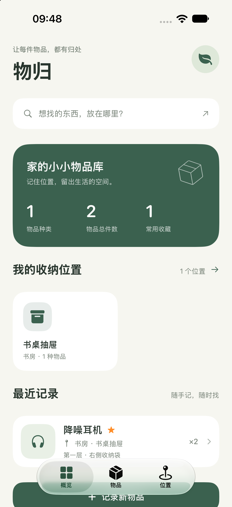
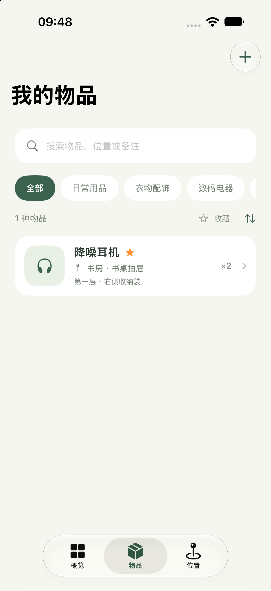

# 物归 · 物品收纳记录 App

中文 SwiftUI 原生 iOS App，最低支持 iOS 17。记录物品、照片和具体收纳位置，轻松找到放在家里的东西。无第三方依赖，数据保存在本机。

采用 [MIT 开源许可证](LICENSE)。

## 界面预览

以下为模拟器中的实际界面，展示的是测试录入的示例记录。

<p>
  
  
</p>

## 在 Xcode 中运行

1. 打开 `WuGui.xcodeproj`。
2. 顶部 Scheme 选择 `WuGui`，运行设备选择一个已安装的 iPhone 模拟器。
3. 按 **⌘R** 运行。

首次打开为空白物品库。可以自行新增位置和物品，也可以在首页下方点击「先看看示例」添加可编辑的示例记录。截图中的测试记录不包含在项目里。

在自己的 iPhone 上运行：连接设备，选中项目的 `WuGui` Target，在 **Signing & Capabilities** 中设置自己的 Development Team，并按需修改 Bundle Identifier。真机安装需要 Apple 开发签名；本次已验证模拟器运行。

## 已实现

- 概览：物品种类、总件数、收藏数、收纳位置与最近记录。
- 物品：新增、编辑、删除、数量、分类、收藏、备注、记录时间。
- 照片：通过系统照片选择器导入，缩放和压缩后保存在本机。
- 搜索：支持名称、分类、房间、收纳位置、具体位置和备注；支持分类筛选、收藏筛选和排序。
- 位置：房间与收纳位置管理，可自选图标和颜色，查看其中的物品，在当前位置直接新增物品。
- 保护：禁止删除仍存放物品的位置；编辑取消前提醒放弃修改；本地写入失败不显示虚假的保存结果。

## 数据与备份

数据存储在 App 沙盒 Documents 下的 `inventory.json`，照片随记录保存在同一文件。文件采用原子写入；若读取损坏数据或不支持的版本，会保留原文件并停止覆盖写入。

这是本地版本，未接入账号或云同步。卸载 App 会删除本机数据。可在连接 iPhone 的 Finder 文件共享页面中备份「物归」的 `inventory.json`；恢复时先完全关闭 App，再将备份文件放回同一位置，重新打开。

照片选择器仅访问你选择的照片，不请求整个相册的访问权限。

## 验证

在 Xcode 中按 **⌘U** 运行 6 项数据测试，覆盖保存后重读、照片数据保留、编辑与收藏、移动物品后的删除保护、无效输入、重复位置、损坏数据保护、新版本文件保护、磁盘写入失败。

当前验证环境：Xcode 27、iOS 27、iPhone 18 Pro 模拟器。**编译成功，6 项测试全部通过**。同时通过模拟器界面验证了新增位置、录入物品、分类和收藏、编辑数量和位置、搜索命中与无结果、重启保留数据。照片选择流程尚未做真机验证。

也可以在终端运行测试，设备名称替换为本机已安装的模拟器：

```sh
xcodebuild -project WuGui.xcodeproj \
  -scheme WuGui \
  -destination 'platform=iOS Simulator,name=iPhone 18 Pro' \
  test CODE_SIGNING_ALLOWED=NO
```

欢迎通过 Issues 反馈问题，或提交 Pull Request。提交修改前请运行数据测试，并说明你使用的 Xcode 和模拟器版本。

## 项目结构

| 文件 | 用途 |
| --- | --- |
| `WuGuiApp.swift` | App 入口 |
| `Models.swift` | 数据模型和 JSON 文件存储 |
| `InventoryStore.swift` | 校验、增删改、持久化 |
| `RootView.swift` | 标签导航和概览 |
| `ItemsView.swift` | 搜索列表和物品详情 |
| `PlacesView.swift` | 位置列表和详情 |
| `Editors.swift` | 物品、照片与位置编辑 |
| `Components.swift` | 颜色和公共界面组件 |
| `WuGuiTests/InventoryTests.swift` | 数据测试 |

`首页.png` 和 `物品列表.png` 为本次模拟器的实际截图。
